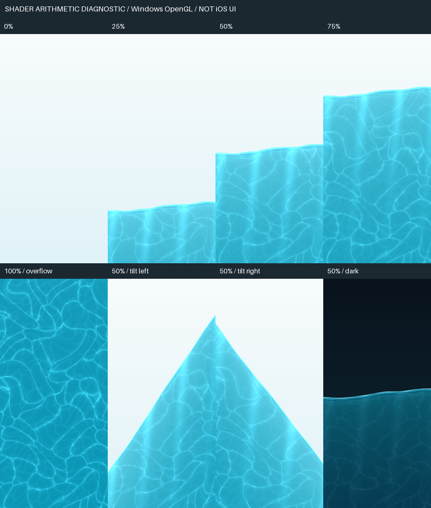

# 原生水体首页实施记录

本轮已完成本地源码实现，尚未完成 iOS 编译和真机验收。基线 `71ac9f52`，继续原 `main` checkout；按用户后续授权提交源码，由用户在另一台电脑打包，本轮不构建或发布安装包。原有调研文档与批准概念图未改动。

## 2026-10-23 用户截图反馈修正

水位修正在 `94f4d351` 基线上完成，中央按钮修正基于 `92047ad6`，均保留已有图标提交。用户截图显示已记录 1000 mL、目标尚未设置、背景没有水，以及“开始”仍是普通播放图标。用户随后明确要求正中间凸起的大按钮，并提供旧版底栏作为参考。

- 最终顺序为“今天 / 计划 / 开始 / 身体 / 喝水”，移除右侧 `.search` / `.prominent` 方案。系统 TabView 保留五个真实导航项，中间第三项继续负责导航和无障碍；其上叠加直径最高 60 pt、向上突出 16 pt 的原生 SwiftUI 圆形加号 Button，使用交互式 Liquid Glass，打开既有 WorkoutView。活跃训练保留“练”标记。**这是原生组件组合的定制布局，不是系统 TabView 的现成中央凸起样式，也不是整条自绘底栏。** 依据：[Apple UITabBar](https://developer.apple.com/documentation/uikit/uitabbar)、[SwiftUI Liquid Glass](https://developer.apple.com/documentation/swiftui/applying-liquid-glass-to-custom-views)。
- `NativeTabBarAnchor` 只读取公开 UITabBar 几何位置，中央按钮按当前容器中线定位，不访问或替换系统私有子视图。关闭滚动时收缩底栏，避免中央按钮与导航脱离；键盘弹出时隐藏叠加按钮。原生中间 Tab 保留供 VoiceOver / 键盘使用，叠加按钮不重复加入无障碍焦点；按钮在 RootView 内，服从正常 sheet 层级。未测得底栏或 iPad 使用顶部标签时回退到普通中央圆形加号 Tab。
- 原因是 `progress` 在未设目标时返回 0，首页又将它直接作为水位。现将目标完成率与水位分开：未设目标时，以界面明确标注的 2000 mL 满刻度显示实际饮水量；1000 mL 对应半屏，0 mL 仍为空。这个刻度不写入每日目标，也不作为提醒取消条件。设置目标后水位沿用用户目标，超过刻度时水位最多满屏，实际 mL 保持不变。
- 水位修正已添加两项 XCTest 回归案例，覆盖截图的 1000 mL / 无目标、超刻度、撤销、跨日、提醒不被误取消、设置/更改/清除目标和记录保持。中央按钮的静态检查在 `92047ad6` 加本次改动的独立快照中进行，未纳入同时编辑中的身体页文件；证据 JSON 明确记录此范围。Swift 测试仍未执行，中央按钮的实际凸起高度/点击范围/VoiceOver/横竖屏/键盘与修正后水体仍待 Mac / iPhone 验证。未改动 shader，因此没有重复生成或冒充新的原生效果图。

## 已实现的源码

- 首页只保留今日训练、今日饮水和今日服用。训练为只读摘要，继续使用底部“开始”；首页没有日期选择、周历、称重入口或第二个开始按钮。
- 保留系统 `TabView` / `Tab`、`NavigationStack`、原生表单、日期时间选择器、弹窗和 `.glass` 按钮；按用户修正将原生加号 Button 叠加在底栏正中间。普通信息卡用系统 Material，水体延伸到安全区和 Tab 栏背后。没有 WebView、自绘 Tab 栏或概念图背景贴图。
- 全屏 Metal 青蓝水体、细水面高光、折射、两层弯曲焦散、深浅色。Core Motion 提供重力和线性加速度，Wave 标量弹簧驱动倾角、加水和衰减回荡；逐帧计算截面水量，倾斜和近满/近空时通过求解水线保持体积。超过目标保留真实数值，背景最多填满。
- 水体与文字/控件是分离的视图，折射只应用于背景。首页不可见、覆盖表单、App 非活跃时停止显示刷新和运动采样；减少动态、低电量、严重发热时静止；降低透明度时用静态纯色水位；无运动传感器时保留自然水纹，倾角归零。目标刷新率 30 Hz，尚未测量 iPhone 帧率/耗电。
- 饮水可配置目标和杯量，快捷追加、自定义、撤销、修改量/时间、按日查看和删除。第一次启动饮水为零，目标未设置，未写入概念图中的示例数据。
- B 沿用用户每天 3 次的计划，按当日 3 个稳定实例记录；D 每周 1 次，星期由用户设置，非计划日不制造今日目标。逐次确认、撤销、去重，修改时点不重置完成记录；改 D 的星期也不会在同一周多累计一次。未设置时点不安排服用提醒；没有剂量建议。
- 饮水和服用提醒分别开关，读取系统真实授权状态。只有用户保存开启设置才请求权限。采用未来 7 天的一次性本地提醒，已服用实例与当天已达饮水目标会取消剩余提醒，每次前台打开及跨日续排。上限不足或添加失败会显示真实结果。**超过 7 天不打开 App，提醒将停止**，界面已说明此边界。
- 饮水/服用独立原子保存到 Application Support/openGym/wellness-state.json。写成功才更新界面；读取失败保护原文件并拒绝覆盖。既有 gym-state.json 与训练/体重 Snapshot 未改变。体重目标编辑移到身体页，保留原功能。

这是 2.5D 水面与光学表现，并非完整流体求解器；开源项目也没有被称为一体化水体引擎。

## 复用与许可证

按文件/算法最小引入，无新增运行时包依赖，也无需 Xcode 额外下载 Swift package：

| 来源 | 固定 revision | 使用方式 |
|---|---|---|
| [Inferno](https://github.com/twostraws/Inferno) | `a40c7a0bdec03aae1bd0b96c41d6a75451bafd2c` | Water.metal 的 float sin/cos 折射与相位处理，适配为程序化水体坐标 |
| [Wave](https://github.com/jtrivedi/Wave) | `27b7e1d2d42b8a4f56d9e84213910b0441c8b810` | Spring / SpringInterpolatable 的标量力与阻尼积分；加入固定子步、范围保护和水面求解 |
| [SwiftUIShaders](https://github.com/krispuckett/SwiftUIShaders) | `6b644a8bd4f3131401bd6765990e476352d3cdef` | underwater-caustics 的双层 cellular light 思路；改为最近边缘光纹、弯曲域，省去多层 FBM 和纹理采样 |

MIT 全文与改动说明保存在 `frontend/ios/App/App/Native/WaterThirdPartyNotices.txt`，已作为 App resource 接入，设置页可查看。Foil alpha、Liquid 和未核实授权的 WebGL Water 均未引入。

## 主要代码入口

| 文件（位于 frontend/ios/App/App/Native） | 用途 |
|---|---|
| TodayView.swift | 首页稳定内容和原生交互 |
| WaterBackground.swift / WaterMotion.swift / WaterPhysics.swift / WaterScene.metal | 背景、Core Motion 生命周期、阻尼与守恒截面、Metal 渲染 |
| WellnessModels.swift / WellnessPersistence.swift / WellnessStore.swift | 日期/实例规则、独立磁盘存档、状态写入 |
| WaterView.swift | 饮水历史、纠正、服用逐次确认和撤销 |
| WellnessSettingsSheet.swift / WellnessNotifications.swift | 计划时点、杯量、真实授权和本地提醒 |
| RootView.swift / GymStore.swift / BodyView.swift | 保留系统导航、跨日刷新与既有功能入口 |
| NativeTabBarAnchor.swift | 读取公开底栏位置，为正中间凸起加号提供布局锚点 |

## 本轮证据

| 检查 | 实际结果与范围 |
|---|---|
| Swift 语法树解析 | 本次独立快照中 23 个文件解析无 ERROR / missing node；不是 Swift 类型检查，也不包含其它任务未提交修改 |
| Xcode 工程结构 | 对象 ID、全部 Native 源文件、Metal Sources、许可 Resources、Info.plist 均通过静态检查 |
| 首页范围检查 | 源码中为系统 5 个 Tab，无首页日期选择/周历/称重/训练开始调用，无 WebView |
| 水体运算预览 | 生产 Metal 代码作类型别名转换，在 Windows RTX 3060 的离屏 OpenGL context 编译并渲染；查看了 0/25/50/75/100%、两向倾斜和深色截图。发现并修正了过于规则的焦散格线 |
| 12 项 Swift XCTest | 已加入，覆盖无目标时水量可见、目标切换与提醒独立、空初始数据、跨日、B/D 去重、每周改日、原子存取/纠正/撤销、损坏文件保留、提醒取消、DST/跨年、截面体积、弹簧衰减。当前没有 Swift 工具链，**未执行** |
| iOS / Metal 编译 | **未执行**：Windows 无 Xcode，未获得可用 Mac 入口 |
| iPhone 视觉/交互/性能 | 用户已提供旧版问题截图；**修正后未验证**，无新版原生运行截图、重力方向真机证据、帧率、耗电或热测试 |

静态检查及源码 SHA-256：[water-home-static-checks-2026-10-23.json](water-home-static-checks-2026-10-23.json)。

下图只用于查看水体纹理和截面，**不是 iOS 截图，不包含 SwiftUI 或系统 Liquid Glass**：



## 复现检查

Windows 静态检查（依赖可装到临时目录，不是 App 依赖）：

```text
python -m pip install tree-sitter==0.26.0 tree-sitter-swift==0.7.4 openstep-parser==2.0.3
python scripts/ios/check-native-home.py
python -m pip install moderngl==5.13.0 glcontext==3.1.0 pillow==13.0.0
python scripts/ios/render-water-diagnostic.py docs/dev/water-home-evidence-2026-10-23
```

Mac / Linux / Windows 的 Swift 5.9+ 环境可运行纯逻辑测试，不需要 CocoaPods 或签名：

```sh
swift test --package-path frontend/ios
```

实际 App 部署目标原本就是 iOS 26，需 Xcode 26+。本 checkout 原有的 Pods、public、capacitor.config.json、config.xml 都是生成物，目前不存在。Mac 上先生成这些既有壳依赖，再做未签名模拟器编译：

```sh
cd frontend
npm ci
VITE_MOBILE=1 npx vite build
npx cap sync ios
cd ios/App
xcodebuild -workspace App.xcworkspace -scheme App -sdk iphonesimulator \
  -destination 'generic/platform=iOS Simulator' \
  -derivedDataPath /tmp/opengym-water-home-derived CODE_SIGNING_ALLOWED=NO build
```

上述 Mac 命令本轮均未执行，不能把步骤本身当作成功记录。

## 尚未关闭的交付门槛

1. Xcode 类型检查、Metal 编译、Swift XCTest 和完整模拟器运行。
2. 真机横竖屏重力方向、突然停止后的回荡、加水动画、连续切 Tab/前后台/表单、系统 Liquid Glass 对水色的真实采样。
3. 小屏、最大动态字体、VoiceOver、深浅色、降低透明度、减少动态、低电量，以及 0/25/50/75/100% 与超目标的原生布局。
4. 实际存档重启/跨日、写入失败、通知拒绝/撤权、到时送达、同周修改 D 星期、撤销后重新排程。
5. iPhone 帧率、GPU 时间、温升、耗电和长期运行；Windows GPU 输出不代替这些数据。
6. **WidgetKit 桌面快捷记录尚未实现**：尚无 widget extension / App Group / AppIntent。应在 Mac 上接入共享存储与签名后制作，不能把当前首页或静态卡片记作小组件完成。

数据目前是原生本机持久化，与现有原生 GymStore 的存储方式一致；本轮未增加服务端同步，也未改动线上用户数据。
