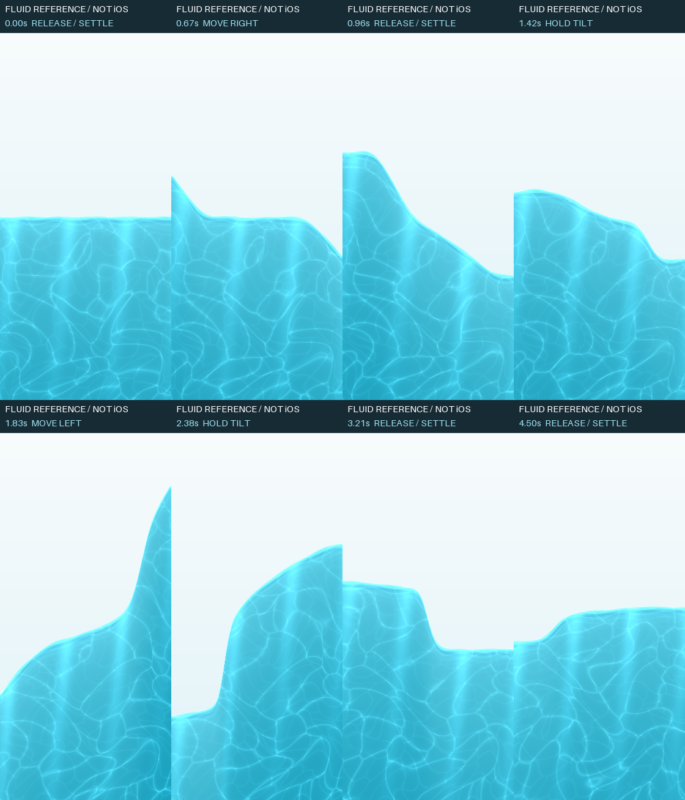

# 原生水体首页实施记录

本轮已完成本地源码实现，尚未完成 iOS 编译和真机验收。基线 `71ac9f52`，继续原 `main` checkout；按用户后续授权提交源码，由用户在另一台电脑打包，本轮不构建或发布安装包。原有调研文档与批准概念图未改动。

## 2026-10-23 最新反馈：独立圆按钮与传播的水波

用户明确要求左侧“开始”是独立圆形按钮，右侧才是导航页签；晃动手机时应出现局部波峰、拍壁与回落，不能只让一条水面绕中点旋转。

- 左侧是 60 pt 原生 SwiftUI 加号 Button，右侧是四项导航胶囊，二者间距 12 pt；GlassEffectContainer 的合并距离设为 6 pt，静止时不会融合。使用系统 Liquid Glass 材质，不读取或覆盖系统 TabBar 几何。四个实际 Tab 保留各自 NavigationStack；训练作为独立内容入口，沿用既有选择训练、继续训练和全屏训练流程。键盘出现时收起底部组件，VoiceOver 分别读取动作与导航项。**这是原生控件组成的定制布局，不是 UITabBar 提供的现成“左侧分离动作”样式。** 依据：[Apple Liquid Glass 组合](https://developer.apple.com/documentation/swiftui/applying-liquid-glass-to-custom-views)。
- 移除整体倾角和单个波幅参数。水体改为 64 个相邻单元，每格存储水深与动量；用一维浅水方程、Rusanov 通量和反射边界计算水量流动。重力与线性加速度作为力进入模拟，侧壁先堆水，再向内形成传播的波峰；释放后惯性继续传播并逐渐耗散。参考方程：[Clawpack shallow-water equations](https://www.clawpack.org/riemann_book/html/Shallow_water.html)。这部分是项目自行实现，没有引入 Clawpack 运行时。
- 加水在局部触发扰动，明显竖向冲量也会产生局部波纹；使用 CFL 条件选择子步，独立于 15/30/60 Hz 显示帧率。封闭边界、干区和顶部约束下校正水量，0/满屏不制造额外水。旋转窗口时保留水量与归一化波形。
- shader 接收每格水深、流速和泡沫数组，按局部水深画水面，折射跟随局部流速；压缩波和撞壁产生短暂泡沫。数组按 Apple 的 `device const float *ptr, int count` 参数对接入：[Shader.Argument](https://developer.apple.com/documentation/swiftui/shader/argument)。降低透明度路径读取同一段水面，减少动态时回归静水。
- 上一轮 UIKit → SwiftUI 场景同步、逐帧发布、Core Motion 回调/加速度计降级、旧回调失效检查、低电量降帧和临界发热暂停继续保留。没有传感器时，光学水纹仍按时钟更新。
- 更新了 11 项 Swift 水体运动用例，以及原来的极端水量守恒用例，覆盖壁面起波而非中点旋转、局部波传播/反射、释放后的回落、帧率、加水、窗口尺寸、竖向冲量与异常输入。**Windows 无 Swift 工具链，这些 XCTest 未执行。**

Windows 已运行独立 Python 数值参考模型，并将生产 Metal 的运算转换为 GLSL 做 192 帧离屏渲染；检查了局部波形、两侧传播与回落。参考模型水量最大误差约 3.3e-16，15/60 Hz 的水深最大差约 8.8e-5，释放 10 秒后波幅低于 0.001。**这些是数值参考与着色器运算证据，不是 Swift 执行、Metal 编译、原生底栏视觉或 iPhone 传感器验证。**



[连续水波诊断动画](water-slosh-evidence-2026-10-23/water-slosh-diagnostic.webp) · [运算证据与源码哈希](water-slosh-evidence-2026-10-23/shader-diagnostic.json)

此前“1000 mL / 未设置目标无水”的修正继续保留：未设目标时使用界面标注的 2000 mL 满刻度显示水量，不会把此显示刻度写为每日目标或当成取消提醒的条件。系统五 Tab 和中央凸起按钮的旧方案已被本节布局替代。

## 已实现的源码

- 首页只保留今日训练、今日饮水和今日服用。训练为只读摘要，继续使用底部“开始”；首页没有日期选择、周历、称重入口或第二个开始按钮。
- 保留四个 Tab 内容和 NavigationStack；底栏用独立圆形加号及四项玻璃导航胶囊组合。表单、日期时间选择器和弹窗继续使用原生控件，水体延伸到安全区与底栏背后，没有 WebView 或背景贴图。
- 全屏 Metal 青蓝水体、细水面高光、折射、两层弯曲焦散、深浅色。Core Motion 提供重力和线性加速度，64 格浅水模拟驱动流速、波峰传播和反射；Wave 弹簧仅平滑记录水量的增减，不再驱动整体角度。超过目标保留真实数值，背景最多填满。
- 水体与文字/控件是分离的视图，折射只应用于背景。首页不可见、覆盖表单、App 非活跃时停止显示刷新和运动采样；减少动态或临界发热时静止；低电量/严重发热目标 15 Hz；降低透明度使用仍受重力驱动的不透明水面；无运动传感器时保留自然光学水纹，模拟不施加侧向外力。正常目标刷新率 30 Hz，尚未测量 iPhone 帧率/耗电。
- 饮水可配置目标和杯量，快捷追加、自定义、撤销、修改量/时间、按日查看和删除。第一次启动饮水为零，目标未设置，未写入概念图中的示例数据。
- B 沿用用户每天 3 次的计划，按当日 3 个稳定实例记录；D 每周 1 次，星期由用户设置，非计划日不制造今日目标。逐次确认、撤销、去重，修改时点不重置完成记录；改 D 的星期也不会在同一周多累计一次。未设置时点不安排服用提醒；没有剂量建议。
- 饮水和服用提醒分别开关，读取系统真实授权状态。只有用户保存开启设置才请求权限。采用未来 7 天的一次性本地提醒，已服用实例与当天已达饮水目标会取消剩余提醒，每次前台打开及跨日续排。上限不足或添加失败会显示真实结果。**超过 7 天不打开 App，提醒将停止**，界面已说明此边界。
- 饮水/服用独立原子保存到 Application Support/openGym/wellness-state.json。写成功才更新界面；读取失败保护原文件并拒绝覆盖。既有 gym-state.json 与训练/体重 Snapshot 未改变。体重目标编辑移到身体页，保留原功能。

这是有水量守恒和波传播的二维截面表现；仍不是完整三维流体、可翻卷的破碎波或飞溅粒子模拟。

## 复用与许可证

按文件/算法最小引入，无新增运行时包依赖，也无需 Xcode 额外下载 Swift package：

| 来源 | 固定 revision | 使用方式 |
|---|---|---|
| [Inferno](https://github.com/twostraws/Inferno) | `a40c7a0bdec03aae1bd0b96c41d6a75451bafd2c` | Water.metal 的 float sin/cos 折射与相位处理，适配为程序化水体坐标 |
| [Wave](https://github.com/jtrivedi/Wave) | `27b7e1d2d42b8a4f56d9e84213910b0441c8b810` | Spring / SpringInterpolatable 的标量力与阻尼积分；只用于水量增减的平滑 |
| [SwiftUIShaders](https://github.com/krispuckett/SwiftUIShaders) | `6b644a8bd4f3131401bd6765990e476352d3cdef` | underwater-caustics 的双层 cellular light 思路；改为最近边缘光纹、弯曲域，省去多层 FBM 和纹理采样 |

MIT 全文与改动说明保存在 `frontend/ios/App/App/Native/WaterThirdPartyNotices.txt`，已作为 App resource 接入，设置页可查看。Foil alpha、Liquid 和未核实授权的 WebGL Water 均未引入。

## 主要代码入口

| 文件（位于 frontend/ios/App/App/Native） | 用途 |
|---|---|
| TodayView.swift | 首页稳定内容和原生交互 |
| WaterBackground.swift / WaterMotion.swift / WaterPhysics.swift / WaterScene.metal | 背景、Core Motion 生命周期、阻尼与守恒截面、Metal 渲染 |
| WellnessModels.swift / WellnessPersistence.swift / WellnessStore.swift | 日期/实例规则、独立磁盘存档、状态写入 |
| WaterView.swift | 饮水历史、纠正、服用逐次确认和撤销 |
| WellnessSettingsSheet.swift / WellnessNotifications.swift | 计划时点、杯量、真实授权和本地提醒 |
| RootView.swift / GymStore.swift / BodyView.swift | 保留系统导航、跨日刷新与既有功能入口 |
| ../SceneDelegate.swift | 将 UIKit 场景生命周期传入 SwiftUI，驱动首页与水体恢复 |

## 本轮证据

| 检查 | 实际结果与范围 |
|---|---|
| Swift 语法树解析 | 当前提交快照中 6 个改动 Swift 文件及 SceneDelegate / Package 依赖解析无 ERROR / missing node；不是 Swift 类型检查，不把其它未提交代码计作通过 |
| Xcode 工程结构 | 对象 ID、全部 Native 源文件、Metal Sources、许可 Resources、Info.plist 均通过静态检查 |
| 首页范围检查 | 源码为 4 个 Tab 内容和独立圆按钮；首页范围检查与无 WebView 检查 |
| 水体运算预览 | 生产 Metal 代码作类型别名转换，在 Windows RTX 3060 的离屏 OpenGL context 编译并渲染；查看了 0/25/50/75/100%、两向倾斜和深色截图。发现并修正了过于规则的焦散格线 |
| Swift XCTest | 水体运动现为 11 项，另保留业务用例并更新极端水量守恒检查；覆盖无目标时水量可见、目标切换与提醒独立、空初始数据、跨日、B/D 去重、每周改日、原子存取/纠正/撤销、损坏文件保留、提醒取消、DST/跨年、截面体积、弹簧衰减。当前没有 Swift 工具链，**未执行** |
| iOS / Metal 编译 | **未执行**：Windows 无 Xcode，未获得可用 Mac 入口 |
| iPhone 视觉/交互/性能 | 用户已提供旧版问题截图；**修正后未验证**，无新版原生运行截图、重力方向真机证据、帧率、耗电或热测试 |

静态检查及源码 SHA-256：[water-home-static-checks-2026-10-23.json](water-home-static-checks-2026-10-23.json)。

下图只用于查看水体纹理和截面，**不是 iOS 截图，不包含 SwiftUI 或系统 Liquid Glass**：


## 复现检查

Windows 静态检查（依赖可装到临时目录，不是 App 依赖）：

```text
python -m pip install tree-sitter==0.26.0 tree-sitter-swift==0.7.4 openstep-parser==2.0.3
python scripts/ios/check-native-home.py
python -m pip install numpy moderngl==5.13.0 glcontext==3.1.0 pillow==13.0.0
python scripts/ios/render-water-diagnostic.py docs/dev/water-slosh-evidence-2026-10-23
```

Mac / Linux / Windows 的 Swift 5.9+ 环境可运行纯逻辑测试，不需要 CocoaPods 或签名：

```sh
swift test --package-path frontend/ios
```

实际 App 部署目标原本就是 iOS 26，需 Xcode 26+。本 checkout 原有的 Pods、public、capacitor.config.json、config.xml 都是生成物，目前不存在。Mac 上先生成这些既有壳依赖，再做未签名模拟器编译：

```sh
cd frontend
npm ci
VITE_MOBILE=1 npx vite build
npx cap sync ios
cd ios/App
xcodebuild -workspace App.xcworkspace -scheme App -sdk iphonesimulator \
  -destination 'generic/platform=iOS Simulator' \
  -derivedDataPath /tmp/opengym-water-home-derived CODE_SIGNING_ALLOWED=NO build
```

上述 Mac 命令本轮均未执行，不能把步骤本身当作成功记录。

## 尚未关闭的交付门槛

1. Xcode 类型检查、Metal 编译、Swift XCTest 和完整模拟器运行。
2. 真机横竖屏重力方向、突然停止后的回荡、加水动画、连续切 Tab/前后台/表单、系统 Liquid Glass 对水色的真实采样。
3. 小屏、最大动态字体、VoiceOver、深浅色、降低透明度、减少动态、低电量，以及 0/25/50/75/100% 与超目标的原生布局。
4. 实际存档重启/跨日、写入失败、通知拒绝/撤权、到时送达、同周修改 D 星期、撤销后重新排程。
5. iPhone 帧率、GPU 时间、温升、耗电和长期运行；Windows GPU 输出不代替这些数据。
6. **WidgetKit 桌面快捷记录尚未实现**：尚无 widget extension / App Group / AppIntent。应在 Mac 上接入共享存储与签名后制作，不能把当前首页或静态卡片记作小组件完成。

数据目前是原生本机持久化，与现有原生 GymStore 的存储方式一致；本轮未增加服务端同步，也未改动线上用户数据。
